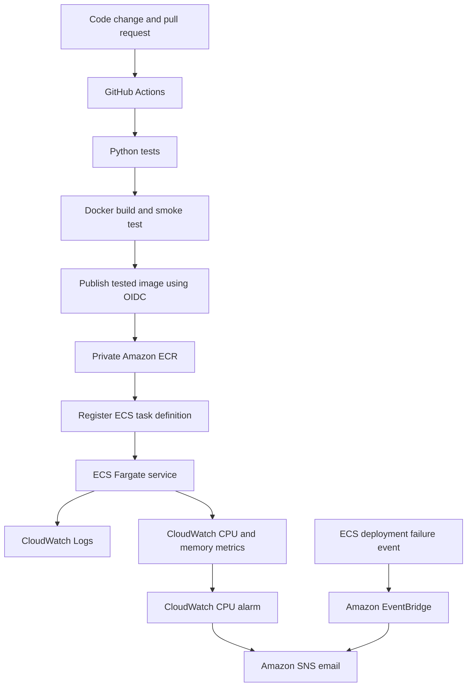

## Project: Automated Docker CI/CD on AWS

### Overview

This hands-on portfolio project demonstrates an automated delivery
pipeline for a Python HTTP application using GitHub Actions, Docker,
Amazon ECR and Amazon ECS Fargate.

The project also demonstrates deployment troubleshooting, automatic
rollback, CloudWatch monitoring, and email notifications.

### Architecture

The EventBridge-to-SNS route is configured, but delivery from an actual
ECS deployment-failure event has not yet been verified end to end.

### Technologies

- Git and GitHub pull requests
- GitHub Actions and YAML
- Python and pytest
- Docker and container hardening
- AWS IAM and GitHub Actions OIDC
- Amazon ECR
- Amazon ECS Fargate
- Amazon CloudWatch Logs, metrics and alarms
- Amazon EventBridge and SNS

### CI/CD workflow

The GitHub Actions workflow validates Python tests, builds the Docker
image and runs a smoke test with a read-only root filesystem,
dropped Linux capabilities, and no-new-privileges enabled.

After a successful push to `main`, the pipeline publishes the tested
image to private ECR using temporary AWS credentials obtained through
GitHub OIDC.

A separate deployment job can register a new ECS task-definition
revision and update the ECS service. Automatic ECS deployment is
currently disabled while the lab is not in use.

### Security practices

- Run the Python application as a non-root user.
- Exclude unnecessary files using `.dockerignore`.
- Use restrictive container runtime settings for smoke tests.
- Use GitHub OIDC rather than long-lived AWS access keys.
- Restrict IAM trust and ECR publishing permissions.
- Restrict inbound application traffic through a security group.

### Troubleshooting and recovery

During a controlled deployment test, a task definition referenced
a deliberately nonexistent ECR image tag. ECS reported
`CannotPullContainerError`.

The deployment circuit breaker marked the new deployment as failed
and rolled back to the previously completed task-definition revision.
The recovered application was then checked through its HTTP endpoints.

The incident procedure is documented in
`docs/ecs-monitoring-runbook.md`.

### Monitoring

The project uses CloudWatch Logs to inspect application activity,
CloudWatch metrics to observe CPU and memory utilisation, and a
CloudWatch CPU alarm connected to an SNS email subscription.

The CPU alarm was tested using a bounded HTTP load test. Its intended
configuration is an 80% threshold for 3 of 5 one-minute periods.

An EventBridge rule is configured for ECS deployment-failure events.
Its full end-to-end notification path remains a validation item.

### Verification

- Python tests and Docker smoke tests passed.
- The published ECR image was pulled and run locally.
- The application returned HTTP 200 from `/` and `/health`.
- An ECS Fargate deployment was successfully tested.
- A controlled image-pull failure demonstrated ECS automatic rollback.
- CloudWatch CPU monitoring triggered an SNS email during a test.

### Cost and cleanup

The ECS services used for learning experiments have been deleted.
The repository, task definitions, monitoring resources and IAM roles
may remain in the AWS account.

ECR storage, CloudWatch logs and monitoring features can still incur
charges, so resource usage and retention should be reviewed.

### Scope

This is a hands-on learning and portfolio project, not a claim of
operating a production environment. The sample application is a small
Python HTTP service and does not implement a production business
workload.
